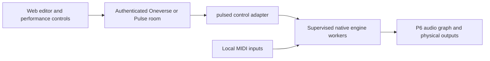

# P7: instruments, plugin racks and web presets

Tracking: [Pulse #5](https://github.com/Vulcio/oneverse-pulse/issues/5).
This is an implementation plan, not a description of delivered plugin hosting. It follows
the audio foundation in [P6](roadmap.md#p6---audio-62) and
[synchronized playback/LTC #4](https://github.com/Vulcio/oneverse-pulse/issues/4).
P1's mini-PC acceptance and P2–P6 remain in their current order. Design and host research can
be prepared earlier; a live plugin feature does not bypass those delivery gates.

## Outcome and initial scope

A musician can use Oneverse's web interface to select a locally installed instrument, edit
its exposed parameters, save a sound, build a rack and recall selected changes for a song or
section. Local MIDI plays the instrument; audio is generated on Pulse, including when the
cloud is unavailable. The browser is a control interface, not the audio transport.

The generic editor covers parameters an engine exposes. Each adapter reports editable and
read-only capabilities; internal features without a supported API are not promised as web
controls. Complete preset state still needs to round-trip when some fields are not editable.

The initial reference slice is FluidSynth with a known test soundfont plus one LV2 test
synth chosen for testable parameter/state support. Native Linux VST3 follows qualification
of that slice. Each engine/plugin/version must earn support through tests; a format label
does not establish compatibility. Linux x86-64 is the initial target.

Windows plugin bridges, macOS Audio Units, arbitrary plugin uploads, streamed native GUIs,
incoming LTC chase and seamless redundant audio machines are deferred. Generic native web
controls are required; a remote desktop is not a substitute for that acceptance criterion.

## Three levels of saved state

The Zynthian-inspired hierarchy becomes a Oneverse model, with its own versioned contract:

| Object | Captures | Example |
| --- | --- | --- |
| Sound preset | One engine's complete state, exposed parameters and required assets | A particular piano or pad |
| Rack snapshot | Instruments/effects, ordered processors, logical audio/MIDI routing, key/velocity splits, layers, mappings and preset references | Piano plus layered pad and shared reverb |
| Performance scene | A revisioned selection of changes against an already prepared rack | Bring in the pad for the chorus |

Store stable engine/plugin and parameter identifiers, format/version, schema version,
owner/scope, object revision, state-artifact hashes and referenced asset hashes. Knob values
alone are insufficient: engines may keep envelopes, samples and internal routing in opaque
state. An adapter must round-trip the complete supported state and identify external files.

Racks use logical buses. A separate device profile maps those buses to actual interface
channels and calibrated latency; importing a rack must not overwrite that hardware profile
or the reserved LTC route. Scenes reference an exact rack revision and selected changes.
Topology changes require preparation of another rack, not unbounded edits in an audio callback.

Cached revisions remain usable offline. Saving is atomic and recoverable after a power loss.
Missing or incompatible plugins/assets block preparation with an actionable report; never
silently load a different sound. Define state/asset sharing and storage permissions before
uploading anything. Plugin binaries are installed separately through trusted packages.

## Ownership and control path

| Component | Owns |
| --- | --- |
| Oneverse core/API | Shared schemas, identity/permissions, preset/rack/scene metadata and revisions, asset references and authoritative session commands |
| Oneverse Pulse Node engine | Authorized room control, local set/state cache, offline session decisions and handback |
| Oneverse web components | Inventory, parameter editor, libraries, rack routing and scene assignment/recall, reused for the local console |
| `pulsed` and native workers | Engine discovery/adapters, DSP/MIDI, local device mapping, preparation, execution, supervision and resource/health reporting |

The room validates intent; native workers apply a validated, scheduled plan. Rust never
becomes a second session reducer. No browser-to-worker public control socket is introduced.
The daemon's own API stays on loopback. Plugin failures must be contained so stems, click
and LTC continue through the P6 foundation.

No new message or permission contract is approved by this document. First design it in
[Oneverse #325](https://github.com/Vulcio/Oneverse/issues/325), document it there and here,
and add conformance fixtures. Required operations include inventory/capability discovery,
parameter/state editing, prepare/preflight, atomic save and scheduled recall, plus applied
or failed acknowledgements. Define revision checks, idempotency, late commands, permissions,
asset limits, offline edits and reconciliation. Differentiate desired state, prepared state
and the revision actually sounding on the device.

## Delivery sequence and acceptance

### P7.0 — qualify the native host and settle the shared contract

Owners: [Pulse #6](https://github.com/Vulcio/oneverse-pulse/issues/6) and
[Oneverse #325](https://github.com/Vulcio/Oneverse/issues/325).

- Compare a Carla backend and LV2 approaches (Jalv/mod-host), plus a FluidSynth adapter.
  Check headless operation, metadata, complete state save/restore, native GUI dependencies,
  JACK/PipeWire/P6 backend fit, isolation, packaging and licences. Selection is not made yet.
- Run reference MIDI/audio fixtures on a named mini PC/interface. Record sample rate, buffer
  size, CPU/memory, note-to-output latency, reported/measured plugin latency, xruns, startup,
  save/restore and worker-crash recovery. Fail candidates that interrupt core playback/LTC.
- Publish numeric pass/fail budgets for latency/jitter, scene activation, skew/drift, CPU/RAM,
  preparation time and recovery. Use P6's timing requirements and measured hardware; freeze
  the budgets before runtime implementation, or revise them explicitly with evidence.
- Design versioned objects, permissions and commands in Oneverse. Test stale revisions,
  duplicate/late/unauthorized requests and complete state fixtures before native integration.

**Exit:** a recorded host decision and tested contract, two reference engines, fixed budgets
and reproducible benchmark instructions. Do not select a host from its advertised formats alone.

### P7.1 — one instrument controlled from the browser

Owners: Pulse #6 and Oneverse #325, after P7.0.

- Supervise real native workers; scan plugins outside the live audio process and quarantine
  crashes. Represent names, units, ranges, enum/toggle types and stable IDs for web controls.
- Build native web inventory and a parameter editor; play through local MIDI with logical
  channel/bus mapping, splits/layers and sustain/expression mappings. Show availability,
  prepared/applied revision, unsaved edits and resource errors.
- Reuse existing role/capability patterns and give operator/admin settings a UI home. Add
  English/French user docs with the implemented interface.

**Exit:** a browser e2e controls an actual reference engine; a known MIDI fixture produces
the expected audio; scan/worker failure leaves P6 core playback and LTC running. The web
test does not use only a mocked host.

### P7.2 — create and recall complete sounds and racks offline

Owners: Pulse #6 and Oneverse #325, after P7.1.

- Create, save, duplicate, rename and recall sounds and full racks from the web library.
- Save complete engine state and referenced assets; retain old valid revisions until the
  replacement is committed. Preflight all sounds required by a set before a show.
- Expose incompatible/missing state and asset reports; preserve local device calibration.
  Define permitted offline editing and resolve conflicts through the Node session authority.

**Exit:** an edited sound and layered rack restore after worker/box restart and with the
cloud disconnected, including parameters absent from the generic editor. Missing assets,
changed plugins, interrupted writes and stale edits have tested, explicit outcomes.

### P7.3 — song/section scenes without breaking playback

Owners: [Pulse #7](https://github.com/Vulcio/oneverse-pulse/issues/7) and Oneverse #325,
after P7.2 and the P6 transport contract.

- Assign scenes to songs/sections and prepare them before activation. Schedule against P6's
  local sample-clock mapping; acknowledge the actual applied revision and timing.
- Specify sustained-note/tail behavior, MIDI cleanup, parameter smoothing and any crossfade.
  Preload a replacement instance where needed and account for its temporary CPU/memory cost.
- Keep allocation, file I/O, plugin loading and state deserialization out of audio callbacks.
  Compensate plugin latency when aligning instruments/effects with stems and LTC.
- Keep LTC on a dedicated output bypassing effects, gain macros and time stretch. State the
  LTC behavior for pause, seek, loop and song transition according to P6's contract.

**Exit:** fixtures verify timed recalls, note continuity and audio/LTC alignment within the
fixed budgets. Late, repeated and unauthorized commands and host crashes are exercised.
Cloud loss and handback never silently restore an older scene or jump the active transport.

### P7.4 — qualify supported plugins and the live rig

Owner: Pulse #7, after P7.3.

- Qualify at least one native Linux VST3 candidate through the same adapter/state tests;
  publish the tested engine/plugin/version matrix and unsupported features.
- Run at least 60 minutes with zero xruns at the documented representative load, alongside
  scheduled scenes, MIDI input, stems/click/LTC, network loss and worker fault injection.
- Record actual hardware, interface, software versions, latency, drift, CPU/memory and
  recovery results. Exercise cold boot and preflight with the full set offline.

**Exit:** reproducible hardware evidence meets P7.0's budgets. CI success alone cannot qualify
the audio interface, real plugin compatibility, dropout resistance or a performance rig.

## References and next action

Zynthian is an architectural reference, not a dependency selected by this plan:
[engine adapters](https://github.com/zynthian/zynthian-ui/tree/vangelis/zyngine),
[state/ZS3 manager](https://github.com/zynthian/zynthian-ui/blob/vangelis/zyngine/zynthian_state_manager.py),
and [Webconf](https://github.com/zynthian/zynthian-webconf).
Other candidates: [Carla](https://github.com/falkTX/Carla),
[mod-host](https://github.com/moddevices/mod-host) and
[MOD UI](https://github.com/moddevices/mod-ui).

The next plugin-specific action is P7.0's host/contract study. Its results must identify the
actual instrument shortlist and target mini-PC/interface before committing to a backend.
The current implementation priority remains completing P1 acceptance and proceeding to P2.
